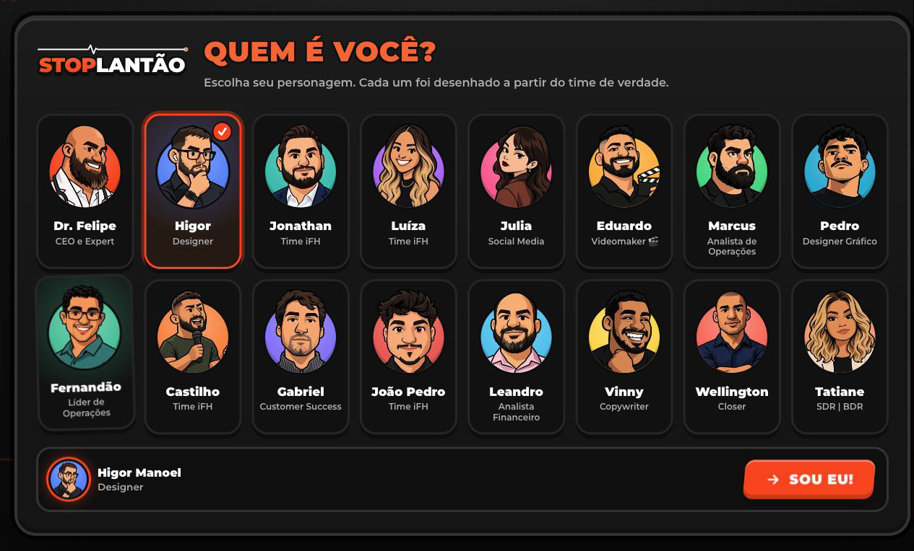
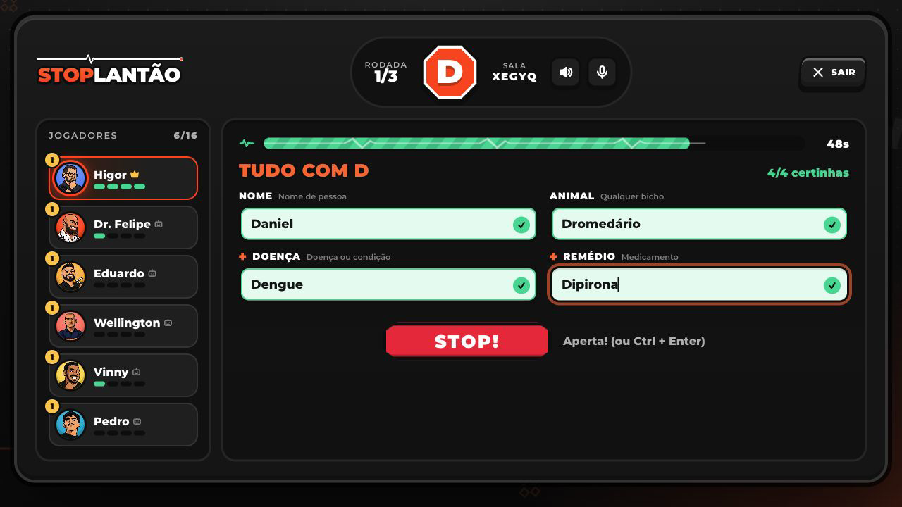
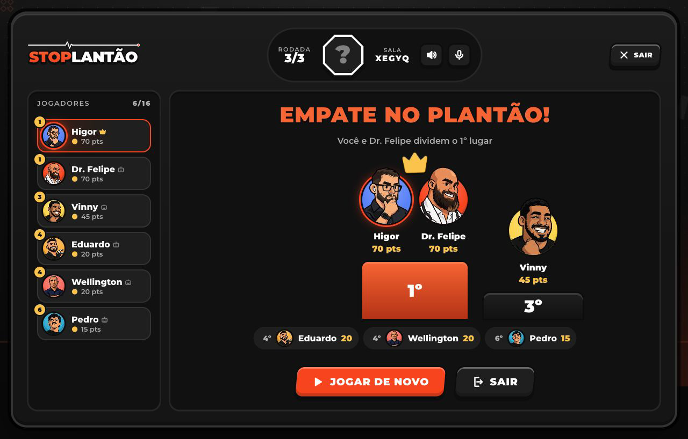

# Stoplantão

**O time iFH virou jogo.**

Criei o Stoplantão para um momento de descontração da equipe. A ideia foi pegar uma brincadeira conhecida e dar a ela a nossa cara: os colegas como personagens, a identidade do iFH e a voz do Dr. Felipe participando da diversão.

**Um pouco dessa experiência, com som:**

https://github.com/user-attachments/assets/b4e90b1a-d7dd-4279-b507-8b2555d9c25b

[Assistir à demonstração com áudio](docs/media/gameplay.mp4)

*Montagem de 26 segundos com trechos do modo treino e áudio do próprio jogo.*

## Uma marca familiar, em clima de brincadeira

Escolhi manter o laranja, o preto e a Montserrat que já fazem parte das peças do iFH. Queria que o jogo fosse reconhecível antes mesmo de alguém começar a jogar.

A partir dessa base, trouxe letras grandes, contornos marcados e botões que lembram peças de um jogo. A intenção foi dar energia e leveza à marca nesse momento de pausa da equipe.

## O time como protagonista

Em vez de personagens genéricos, coloquei as 16 pessoas do time no centro da experiência. A proposta era que cada um pudesse se reconhecer e encontrar os colegas naquele universo.

*O elenco faz parte da identidade do jogo: são as pessoas com quem a equipe convive.*

Escolhi um cartum de contornos pretos grossos, formas geométricas e cores chapadas para afastar os retratos de uma representação formal. O traço simplificado dá espaço à expressão e ao humor, preservando características que ajudam a reconhecer cada pessoa.

Os personagens foram produzidos com IA a partir de referências fotográficas e ajustados para manter a semelhança e a unidade do conjunto. O Dr. Felipe também ganhou poses para acompanhar suas falas.

## O cotidiano entrou na brincadeira

O nome **Stoplantão** junta Stop e Plantão. A referência ao cotidiano aparece com humor: o tempo da rodada lembra um monitor cardíaco, a letra fica em uma placa de PARE e o STOP vira um acontecimento na tela.

*O monitor cardíaco transforma uma função comum, a contagem do tempo, em um detalhe do universo iFH.*

A voz do Dr. Felipe aproxima o jogo de uma presença familiar para o time. As falas, produzidas com IA, aparecem junto de legendas e expressões do personagem. Quis que o som também carregasse a personalidade da experiência.

*Até o encerramento mantém os colegas em cena, com o mesmo tom de brincadeira da partida.*

## O prompt dos personagens

Deixei documentado o [prompt para criar personagens com o mesmo aspecto visual](docs/CHARACTER_PROMPT.md), incluindo a direção do traço, as características individuais e os cuidados para manter a consistência do elenco.

As fotos de referência e os materiais brutos de produção ficam no acervo privado. Aqui estão as ilustrações finais usadas no jogo.
